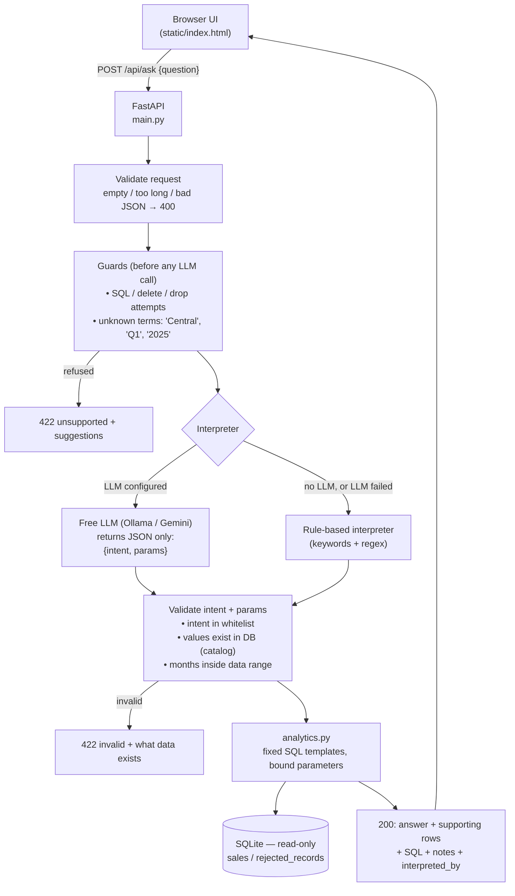

# Architecture

## Request flow



Plain-text version:

```
Browser ──POST /api/ask──► FastAPI ──► validate ──► guards ──► interpreter ──► validate params
                                                                 │  ▲                │
                                                  LLM (JSON only)┘  └ rules fallback │
                                                                                     ▼
                                       answer + rows + SQL ◄── analytics (parameterised SQL) ◄── SQLite (read-only)
```

## Components

| Module | Responsibility | Touches LLM? | Touches DB? |
|---|---|---|---|
| `database.py` | Load CSV, validate/clean rows, quarantine bad rows, open read-only connection | No | Writes only at startup build |
| `analytics.py` | Whitelisted intents → parameterised SQL → answer text + supporting rows | No | Read-only |
| `interpreter.py` | Question → (intent, params): LLM prompt, rule engine, guards, output sanitising | Yes | No |
| `llm.py` | HTTP clients for Ollama / Gemini; all failures become `LLMError` | Yes | No |
| `service.py` | One request end-to-end, maps outcomes to HTTP status | — | Read-only |
| `main.py` | HTTP routes, error handling, static UI | — | — |

## Data model

```
sales(transaction_id PK, order_date ISO, product, category, region, sales_channel,
      quantity > 0, unit_price > 0, discount_amount >= 0, status in {Completed, Returned})
rejected_records(id, source_line, transaction_id, reason, raw_row JSON)
```

`CHECK` constraints in the schema are a second line of defence behind the Python validation.
Indexes on `order_date` and `status` (the two columns every query filters on).

## Key decision: intent routing instead of free-form text-to-SQL

The brief allows text-to-SQL "if validated". I chose **intent + parameter extraction** instead:

| | Text-to-SQL | Intent routing (chosen) |
|---|---|---|
| Wrong-answer risk | High: a plausible but wrong query (e.g. forgetting `status='Completed'`, or double counting) returns a confident wrong number | Low: the business logic (what "revenue" means) is written once, tested, and reused |
| Security | Needs SQL parsing/allow-listing; subtle bypasses | Nothing to bypass: no LLM-written SQL exists |
| Works with small free models | Poor: 3B models write unreliable SQL | Good: a 3B model only fills a small JSON form |
| Flexibility | Any question | Only the 5 intents (+ filters) |

The trade-off is flexibility. With more time I'd add a *validated* text-to-SQL path as a second, clearly-labelled tier for questions no intent covers (see AI_USAGE.md → improvements).

## Defence in depth (what must fail for a wrong/destructive result)

1. Guard refuses SQL/write attempts and unresolvable terms **before** the LLM is called.
2. LLM can only emit one of 5 intents; anything else → fallback to rules.
3. Parameters must match real database values (else 422 with the list of valid values).
4. SQL is fixed text; user values are bound parameters; column names come from a whitelist.
5. The connection is opened read-only (`mode=ro`), so even a code bug cannot write.
6. Schema `CHECK` constraints reject impossible rows.
7. Unexpected exceptions return a generic 500; details only in server logs.

## Failure behaviour

| Failure | Behaviour |
|---|---|
| Ollama not running / timeout / HTTP error | Fall back to rules; response includes `llm_error` and `interpreted_by: rules (LLM unavailable)` |
| LLM returns non-JSON / unknown intent | Same fallback |
| LLM says "unsupported" for something rules understand | Rules answer (`rules (LLM declined)`) — avoids small-model false refusals |
| LLM says "unsupported" for something rules don't understand | Refused, with the LLM's reason |
| LLM invents a region/product/month | 422 `invalid`, lists valid values |
| CSV missing / wrong columns | App refuses to start with a clear error |

## Performance note

The dataset is ~50 rows, so each request rebuilds the small value catalog (`SELECT DISTINCT`) and runs 2–3 queries; this is milliseconds. At scale the catalog would be cached and invalidated on data load.
